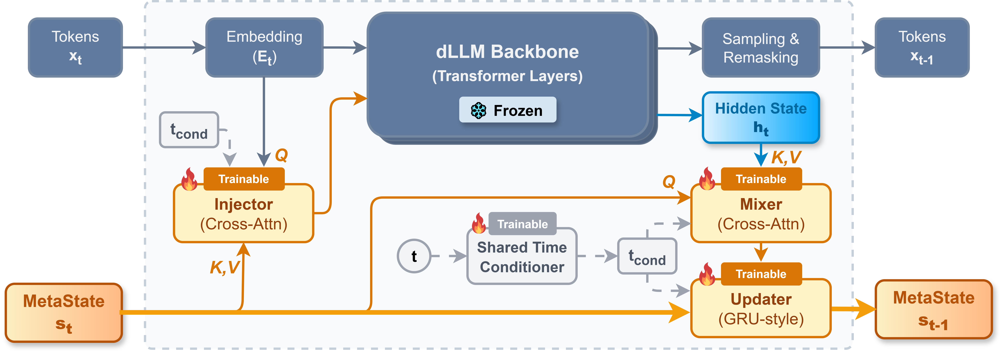

# **MetaState**

### **Persistent Working Memory Enhances Reasoning in Discrete Diffusion Language Models**

This repository contains the official implementation of **MetaState**, a lightweight recurrent augmentation for discrete diffusion language models (dLLMs). MetaState keeps the LLaDA backbone frozen and trains only recurrent working-memory modules that persist information across denoising steps.

Paper: [arXiv:2603.01331](https://arxiv.org/abs/2603.01331)

> Discrete diffusion language models (dLLMs) generate text by iteratively denoising a masked sequence.  However, standard dLLMs condition each denoising step solely on the current hard-masked sequence, while intermediate continuous representations are discarded after sampling and remasking. We term this bottleneck the **Information Island issue**: continuous information remains isolated within individual denoising steps and fails to propagate across the denoising trajectory. This bottleneck is especially harmful for reasoning, which requires intermediate reasoning state to be preserved and updated across many denoising steps. To address this limitation, we introduce **MetaState**, a lightweight recurrent augmentation that equips a frozen dLLM backbone with persistent, fixed-size working memory. MetaState comprises three modules with a shared time conditioner: a cross-attention **Mixer** that reads backbone activations into memory slots, a recurrent **Updater** that integrates information across steps, and a cross-attention **Injector** that writes the updated memory back into the backbone. We train these modules with a dedicated K-step unrolling pipeline to learn multi-step dynamics.

## Highlights

- Recurrent memory slots that carry information across diffusion steps.
- A shared time conditioner for recurrent denoising dynamics.
- Mixer, Updater, and Injector modules for reading from the backbone, updating memory, and writing memory back into token embeddings.
- K-step unrolled supervised fine-tuning on preprocessed SFT data.
- In the active LLaDA-1.5 configuration, MetaState trains about **51.1M / 8.07B parameters (0.63%)**.

## Architecture

<p align="center">
  
</p>

```text
masked input ids
  -> token embeddings
  -> Injector(memory -> embeddings)
  -> frozen LLaDA backbone
  -> Mixer(hidden states -> memory context)
  -> Updater(memory, context)
  -> memory for the next denoising step
```

MetaState targets the Information Island bottleneck in standard dLLMs, where continuous intermediate representations are discarded between denoising steps. The recurrent state gives the model a small persistent workspace while leaving the pretrained backbone unchanged.

## Repository Layout

```text
|-- dllm/
|   |-- core/
|   |   |-- modules/recurrent.py           # Time conditioner, Mixer, Updater, Injector
|   |   |-- samplers/recurrent_mdlm.py     # Recurrent masked-diffusion sampler
|   |   `-- trainers/recurrent_mdlm.py     # K-step recurrent training and checkpoint saving
|   |-- data/utils.py                      # Preprocessed SFT dataset loading
|   |-- pipelines/
|   |   |-- llada/                         # LLaDA model/config code
|   |   |-- recurrent_eval.py              # lm-eval adapter
|   |   `-- recurrent_llada/               # Recurrent LLaDA HF wrapper
|   `-- utils/                             # Configs, tokenizer/model loading, data processing
|-- examples/recurrent_llada/
|   |-- sft.py                             # Training entry point
|   `-- eval.py                            # lm-eval entry point
|-- examples/metastate.png                 # MetaState method figure
|-- scripts/
|   |-- accelerate_configs/zero1.yaml      # DeepSpeed ZeRO-1 Accelerate config
|   |-- collect_results.py                 # lm-eval output to CSV
|   `-- eval_checkpoint.sh                 # Checkpoint evaluation launcher
|-- example_launcher.sh                    # Training plus evaluation launcher
|-- pyproject.toml
`-- README.md
```

## Installation

Python `>=3.10` is required. Install PyTorch for your CUDA/runtime first, then install this package locally:

```bash
conda create -n metastate python=3.10 -y
conda activate metastate

# Choose the correct PyTorch command for your environment:
# https://pytorch.org/get-started/locally/
pip install torch

pip install -e .
```


## Quick Start

`example_launcher.sh` runs the example training command and then evaluates the produced checkpoints with default settings:

```bash
DATASET_ARGS="/path/to/preprocessed_sft[train:20000,test:20]" \
OUTPUT_DIR="/path/to/output_dir" \
bash example_launcher.sh
```

To evaluate an existing checkpoint directly:

```bash
bash scripts/eval_checkpoint.sh \
  --checkpoint_path /path/to/output_dir/checkpoint-1234 \
  --use_cache dual --threshold 0.9 --block_size 32 --max_new_tokens 256
```

## Data

Training expects preprocessed Hugging Face `Dataset` or `DatasetDict` directories loaded with `datasets.load_from_disk`.

`DATASET_ARGS` supports split limits:

```text
/path/to/data[train:20000,test:20]
```

Multiple datasets can be combined with `+` or `|`:

```text
/path/to/data_a[train:10000]+/path/to/data_b[train:10000,test:20]
```


## Training

The training entry point is:

```bash
examples/recurrent_llada/sft.py
```

Minimal direct launch:

```bash
export PYTHONPATH="$(pwd):${PYTHONPATH:-}"

accelerate launch \
  --config_file scripts/accelerate_configs/zero1.yaml \
  examples/recurrent_llada/sft.py \
  --model_name_or_path GSAI-ML/LLaDA-1.5 \
  --backbone_name_or_path GSAI-ML/LLaDA-1.5 \
  --dataset_args "/path/to/preprocessed_sft[train:20000,test:20]" \
  --output_dir "/path/to/output_dir"
```

Common MetaState arguments:

| Argument | Purpose |
| --- | --- |
| `--freeze_backbone` | Keep the LLaDA backbone frozen; defaults to `True`. |
| `--num_memory_slots` | Number of recurrent memory slots. |
| `--state_hidden_size` | Hidden size of each memory slot. |
| `--time_cond_dim` | Time conditioner output dimension. |
| `--mixer_dim` | Mixer bottleneck dimension. |
| `--injector_dim` | Injector bottleneck dimension. |
| `--unroll_steps` | Number of denoising steps unrolled during training. |
| `--unroll_steps_max` | Optional variable-K target. |
| `--reveal_position_policy` | `random`, `gt_confidence_topk`, or `model_confidence_topk`. |
| `--dense_reveal_mix` | Mix between dense masked CE and reveal-token CE. |
| `--state_norm_weight` | Auxiliary state norm penalty. |
| `--slot_diversity_weight` | Auxiliary slot diversity penalty. |
| `--dataset_args` | Preprocessed dataset path and split limits. |
| `--output_dir` | Checkpoint and log directory. |


## Evaluation

Evaluate every `checkpoint-*` directory under an output directory:

```bash
bash scripts/eval_checkpoint.sh \
  --output_dir /path/to/output_dir \
  --num_gpu 2 \
  --use_cache dual \
  --threshold 0.9 \
  --block_size 32 \
  --max_new_tokens 256
```

Evaluate one checkpoint:

```bash
bash scripts/eval_checkpoint.sh \
  --checkpoint_path /path/to/output_dir/checkpoint-1234 \
  --num_gpu 2
```

The evaluation launcher checks that the checkpoint metadata has `model_type == "recurrent_llada"` and runs:

| Task | Few-shot | Notes |
| --- | ---: | --- |
| `gsm8k` | 5 | Math reasoning |
| `humaneval_instruct` | 0 | Code generation, unsafe code execution enabled |
| `mbpp` | 3 | Code generation, unsafe code execution enabled |
| `minerva_math500` | 4 | Math reasoning |

Outputs are written to `results_llada/`:

```text
results_llada/
|-- eval_<model_tag>_<task>_limit1500_fs<k>_s<steps>_mn<max_new_tokens>_<cache>.out
`-- aresults_checkpoint.csv
```

## Checkpoints

MetaState checkpoints are lightweight. They store trainable recurrent modules and metadata needed to reload the frozen backbone:

```text
checkpoint-*/
|-- recurrent_modules.safetensors
|-- recurrent_checkpoint_meta.json
|-- config.json
|-- modeling_recurrent_llada.py
|-- recurrent_llada_config.py
`-- tokenizer files
```

`dllm.utils.get_model(...)` supports:

1. lightweight MetaState checkpoints with `recurrent_checkpoint_meta.json`;
2. full Hugging Face models whose config has `model_type == "recurrent_llada"`;
3. base LLaDA models initialized with new recurrent modules when `is_recurrent=True`.

## Sampling Notes

`RecurrentMDLMSampler` supports:

- `use_cache=None`: full recomputation;
- `use_cache="prefix"`: prompt KV cache;
- `use_cache="dual"`: full KV cache with selective block replacement;
- `threshold`, `factor`, `block_size`, `steps`, and `max_new_tokens` generation controls.

Cache modes require equal prompt lengths. When cache is enabled, `max_new_tokens` must be divisible by `block_size`, and `steps` must be divisible by the number of generation blocks.

## Sanity Checks

```bash
bash -n example_launcher.sh
bash -n scripts/eval_checkpoint.sh
python -m py_compile \
  examples/recurrent_llada/sft.py \
  examples/recurrent_llada/eval.py \
  scripts/collect_results.py \
  dllm/core/modules/recurrent.py \
  dllm/core/trainers/recurrent_mdlm.py \
  dllm/core/samplers/recurrent_mdlm.py \
  dllm/pipelines/recurrent_eval.py \
  dllm/pipelines/recurrent_llada/configs/recurrent_llada_config.py \
  dllm/pipelines/recurrent_llada/models/modeling_recurrent_llada.py
```


## Acknowledgements

This codebase is built on and adapted from [`ZHZisZZ/dllm`](https://github.com/ZHZisZZ/dllm). We thank the authors for releasing the implementation that provided the foundation.

## License

This project is released under the Apache License 2.0. See [LICENSE](LICENSE).

## Citation

```bibtex
@misc{xia2026metastatepersistentworkingmemory,
      title={MetaState: Persistent Working Memory Enhances Reasoning in Discrete Diffusion Language Models},
      author={Kejing Xia and Mingzhe Li and Lixuan Wei and Zhenbang Du and Xiangchi Yuan and Dachuan Shi and Qirui Jin and Wenke Lee},
      year={2026},
      eprint={2603.01331},
      archivePrefix={arXiv},
      primaryClass={cs.CL},
      url={https://arxiv.org/abs/2603.01331},
}
```
